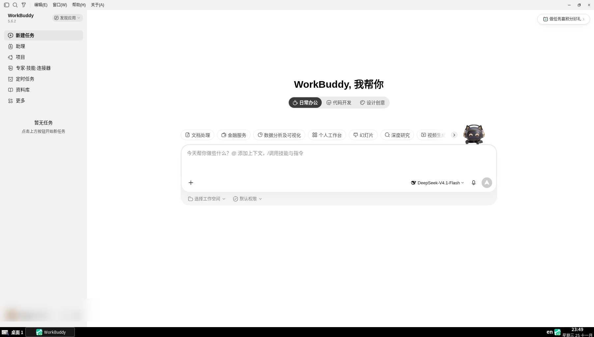
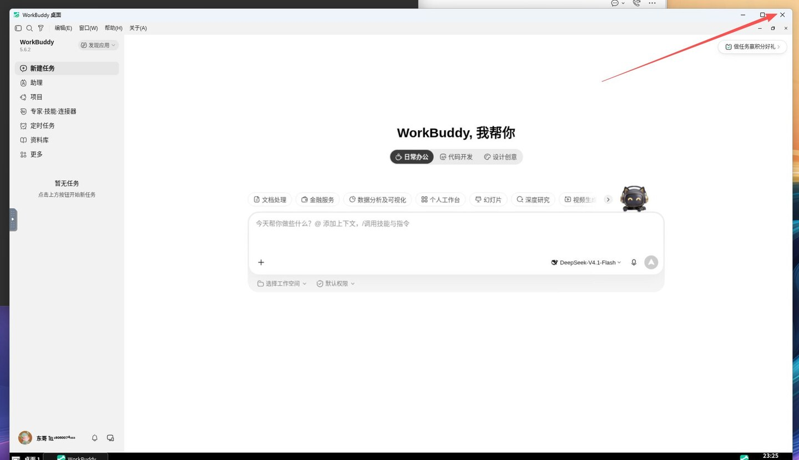
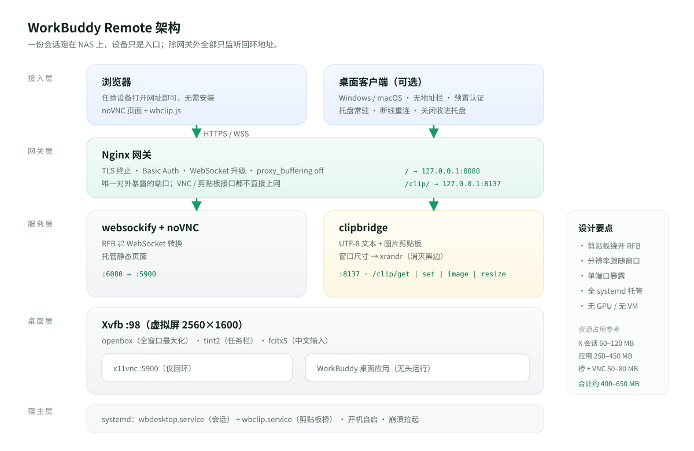
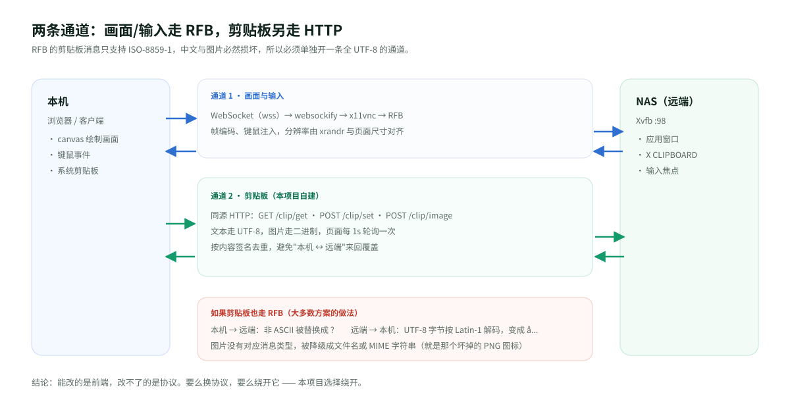

# WorkBuddy Remote

> 把桌面版 AI 工作台搬进浏览器：**一台常开的 NAS 就够了**，上下文不再散落在不同的电脑里。

[-1c9d6e)](docs/deploy.md)
[-1c9d6e)](docs/client.md)
[](LICENSE)
[](docs/vs-vm.md)

---

## 这是什么

一套**无头 Linux 桌面 + 浏览器访问 + 原生客户端**的完整方案，用来把一个只能跑在桌面环境里的 AI 客户端（下称 WorkBuddy）常驻在家里的 NAS 上：

- 服务器侧：Xvfb 虚拟屏 + 轻量窗口管理器 + VNC + WebSocket 网关，全部 systemd 托管，开机即用；
- 访问侧：任意浏览器打开网址就能用；也提供 Windows / macOS 客户端，去掉地址栏、预置认证、常驻托盘；
- 还顺手解决了三个几乎所有远程桌面方案都会踩的坑：**中文剪贴板、图片粘贴、窗口黑边**。



---

## 为什么做这个（初衷）

一开始只是想要"在别的电脑上接着用"。但把现有方案挨个试过之后，问题很集中：

1. **上下文跟着机器跑。** 桌面客户端的数据在各自的电脑上：家里台式机一套会话，笔记本一套，出差临时用平板又是一套。换个设备就等于换个大脑。
2. **想远程用，就得留一台机器开着。** 向日葵 / ToDesk / RDP 都需要被控端一直亮着——多一台常开的 Windows，电费、噪音、系统更新、蓝屏，全是成本。
3. **虚拟机并不划算。** 为了跑一个客户端，要装完整系统镜像、分配内存、装增强工具、处理 USB 与剪贴板重定向；换机时还要迁移镜像。
4. **剪贴板永远是最后一公里。** 远程桌面里复制一段中文，粘到本机变成 `å...` 或者一串 `?`；截个图想贴到微信，得到的是一个文件名。

**所以这个项目的目标很直接**：让一台本来就 7×24 开机的 NAS 承担"唯一的那台机器"，其余设备都退化成显示器。

---

## 这么做的意义

| 传统方式 | 本项目 |
| --- | --- |
| 每台设备一套数据、一套登录 | **一份会话、一处数据**，设备只是入口 |
| 需要一台常开的 PC / 高配 VM | 复用已有的 NAS（通常 10–20W 待机） |
| 远程桌面软件按设备/按年收费 | 全栈自建，无订阅（仅 TLS 证书可选免费方案） |
| 剪贴板靠厂商实现，中文/图片看运气 | 自建 UTF-8 剪贴板桥，文本与图片双向可用 |
| 分辨率固定，窗口一缩放就黑边 | 远端分辨率跟随客户端窗口实时 `xrandr` |

更实际的一点：**这套东西是可描述的**。整个部署就是几个脚本 + 几个 unit 文件，换一台机器重放一遍即可，不依赖某台机器的"手工状态"。这是它比"配置好一台虚拟机然后一直供着"更重要的地方。

---

## 最终效果

- [x] 浏览器直接访问，无需安装任何软件
- [x] Windows / macOS 客户端：无地址栏、内置认证、断线自动重连
- [x] 中文拼音输入（fcitx5）在远端可用
- [x] 剪贴板双向：**中文文本不丢、不乱码**
- [x] 图片双向粘贴：本机截图 → 远端输入框；远端图片 → 微信/文档
- [x] 远端分辨率跟随窗口，**无黑边**
- [x] 关闭窗口收进系统托盘，托盘可唤回/退出
- [x] systemd 开机自启，崩溃自动拉起
- [x] 单端口 TLS + Basic Auth，不把 VNC 直接暴露在公网



<sub>Windows 客户端：没有地址栏和标签页，窗口就是远端桌面本身；关掉窗口会收进托盘，双击图标唤回。</sub>

---

## 整体流程



```
 ┌──────────────┐    HTTPS / WSS (TLS + Basic Auth)    ┌────────────────────────────┐
 │ 浏览器 / 客户端 │ ───────────────────────────────────▶ │  Nginx（反代 + WebSocket）   │
 └──────────────┘                                       └────────────┬───────────────┘
                                                                     │ 127.0.0.1
                                        ┌────────────────────────────┼─────────────────────────┐
                                        ▼                            ▼                         ▼
                                 ┌─────────────┐            ┌────────────────┐        ┌──────────────┐
                                 │ websockify  │            │  clipbridge    │        │ 静态页面      │
                                 │ (noVNC)     │            │ 剪贴板/分辨率桥 │        │ noVNC vnc.html│
                                 └──────┬──────┘            └───────┬────────┘        └──────────────┘
                                        │ RFB                       │ xclip / xrandr
                                        ▼                           ▼
                                 ┌──────────────────────────────────────────┐
                                 │  Xvfb :98 虚拟屏（2560×1600 上限）          │
                                 │  openbox + tint2 + fcitx5                 │
                                 │  └─ WorkBuddy 桌面客户端（无头运行）        │
                                 └──────────────────────────────────────────┘
```

细节见 [架构说明](docs/architecture.md)。

### 两条通道



画面与输入走 RFB（WebSocket 封装），剪贴板另开一条同源 HTTP —— 因为 RFB 的剪贴板通道只支持 Latin-1，无论如何改前端都传不了中文和图片。详见 [剪贴板桥](docs/clipboard.md)。

---

## 快速开始

> 完整步骤、参数说明与排错见 [部署教程](docs/deploy.md)。以下是最短路径（Debian 12 / Ubuntu 22.04 / fnOS 均可）。

**0. 准备**：一台常开的 Linux 主机（x86_64 或 arm64）、你自己合法获取的 WorkBuddy `.deb` 安装包、一个有 sudo 权限的普通用户。

**1. 安装依赖**

```bash
sudo bash scripts/install.sh --deps-only
```

**2. 解包应用并启动会话**

```bash
sudo bash scripts/install.sh --deb ./WorkBuddy.deb --user "$USER"
```

脚本会：解包到 `/opt/wbapp` → 生成 `start-wb.sh` → 安装并启动 `wbdesktop.service`（Xvfb + openbox + tint2 + fcitx5 + x11vnc + websockify）。

**3. 启动剪贴板桥**

```bash
sudo bash scripts/install.sh --clip
```

**4. 挂上页面脚本**

```bash
sudo apt-get install -y novnc
sudo bash scripts/install.sh --web /usr/share/novnc     # 注入 wbclip.js
```

**5. 配一个入口**

```bash
sudo cp scripts/nginx/workbuddy.conf /etc/nginx/conf.d/
sudo nginx -t && sudo systemctl reload nginx
```

同源反代了 `/clip/`，所以剪贴板桥不需要额外开放端口。

**6. 打开**

浏览器访问 `https://你的域名/vnc.html?autoconnect=1&resize=scale`，输入 Basic Auth 账号口令即可。

想要"像本地应用一样"的体验，用 [桌面客户端](docs/client.md)：双击图标直接进入，关窗进托盘。

---

## 组件一览

| 组件 | 作用 | 位置 |
| --- | --- | --- |
| `start-wb.sh` | 拉起虚拟屏、窗口管理器、输入法、VNC、noVNC | `scripts/start-wb.sh` |
| `clipbridge.py` | UTF-8 剪贴板 + 图片 + 分辨率自适应 | `scripts/clipbridge.py` |
| `wbdesktop.service` | 桌面会话常驻 | `scripts/systemd/` |
| `wbclip.service` | 剪贴板桥常驻 | `scripts/systemd/` |
| `workbuddy.conf` | Nginx 反代（含 WebSocket 与 `/clip/`） | `scripts/nginx/` |
| `client/` | Electron 客户端（Win/macOS 打包脚本） | `client/` |

---

## 和虚拟机方案比，好在哪

| 维度 | 虚拟机跑桌面 | 本项目（无头 X 会话） |
| --- | --- | --- |
| 额外常开主机 | 需要（或需要一台能跑 VM 的强机） | 不需要，直接用 NAS |
| 内存占用 | 整机 4–8 GB 起 | 会话约 300–800 MB |
| 磁盘 | 系统镜像 20 GB+ | 只有应用与数据 |
| 启动速度 | 开机 → 进系统 → 开客户端 | systemd 拉起，秒级 |
| 升级 | 重装/重建镜像 | 换 deb，重启服务 |
| 剪贴板 | 依赖增强工具，中文/图片常失败 | 自建桥，全 UTF-8 + 图片 |
| 分辨率 | 固定虚拟屏，缩放留黑边 | 跟随窗口 |
| 快照/备份 | 镜像体积大 | 只有应用数据，`tar` 即可 |
| 隔离性 | 强（整机隔离） | 中（同一用户会话）→ 见[安全说明](docs/security.md) |

结论：**如果目标是"一个人用一个桌面应用"，虚拟机的隔离性换不来它的成本**；如果确实需要强隔离或多用户，另说。

完整对比（含与向日葵/ToDesk/RDP 的对比、功耗与成本估算）见 [docs/vs-vm.md](docs/vs-vm.md)。

---

## 剪贴板为什么要自己写

VNC 协议里的 `ClientCutText` / `ServerCutText` 只按 **ISO-8859-1（Latin-1）** 处理文本，而且主流服务端（x11vnc）本身也把非 ASCII 转成 `?`。所以：

- 远端复制中文 → 本机粘贴得到 `å...`（UTF-8 字节被按 Latin-1 解码）；
- 本机复制中文 → 远端得到一串 `?`；
- 远端复制图片 → 协议里根本没有这个通道，很多方案会退化成"传一个文件名"。

本项目的做法是**绕开 RFB 的剪贴板通道**，用同源 HTTP 接口直接读写 X 剪贴板，文本走 UTF-8，图片走二进制。原理、接口与踩过的坑见 [docs/clipboard.md](docs/clipboard.md)。

---

## 目录结构

```
.
├── assets/                 # 架构图与截图
├── client/                 # Electron 客户端（Windows / macOS）
│   ├── main.js             # 主进程：认证、托盘、关闭策略、快捷键
│   ├── pages/              # 设置页、离线页
│   └── 打包Mac安装包.command
├── docs/
│   ├── architecture.md     # 分层与启动顺序
│   ├── deploy.md           # 从零部署
│   ├── clipboard.md        # 剪贴板桥原理
│   ├── client.md           # 客户端与安装包制作
│   ├── vs-vm.md            # 与虚拟机/远程控制软件对比
│   ├── security.md         # 暴露面与加固
│   └── faq.md              # 常见问题
├── scripts/
│   ├── install.sh
│   ├── start-wb.sh
│   ├── clipbridge.py
│   ├── systemd/
│   └── nginx/
└── README.md
```

---

## 常见问题

- 页面打开是 403 / `Host not allowed` → 见 [FAQ](docs/faq.md#403)
- 中文打不进去 → 输入法没起来或 `GTK_IM_MODULE` 没设，见 [FAQ](docs/faq.md#ime)
- 粘贴图片变成文件名 → 剪贴板桥没跑，或页面是旧缓存（硬刷新）
- 窗口有黑边 → 客户端未上报窗口尺寸，见 [FAQ](docs/faq.md#letterbox)
- 关窗后进程还在 → 这是设计行为（收进托盘），托盘菜单可退出

---

## 免责声明

本项目**不是**官方项目，与 WorkBuddy、腾讯及其关联公司没有任何隶属或背书关系；相关名称与商标归其权利人所有。

本项目**不提供、不分发**任何 WorkBuddy 安装包或闭源二进制，仅包含部署脚本、剪贴板桥与客户端壳代码。使用者需自行合法获取软件并遵守其许可协议。

部署到公网前请务必阅读 [docs/security.md](docs/security.md)。因使用本项目造成的任何直接或间接损失，作者不承担责任。详见 [DISCLAIMER.md](DISCLAIMER.md)。

---

## 许可

代码以 [MIT](LICENSE) 许可发布。文档以 CC BY 4.0 发布。
