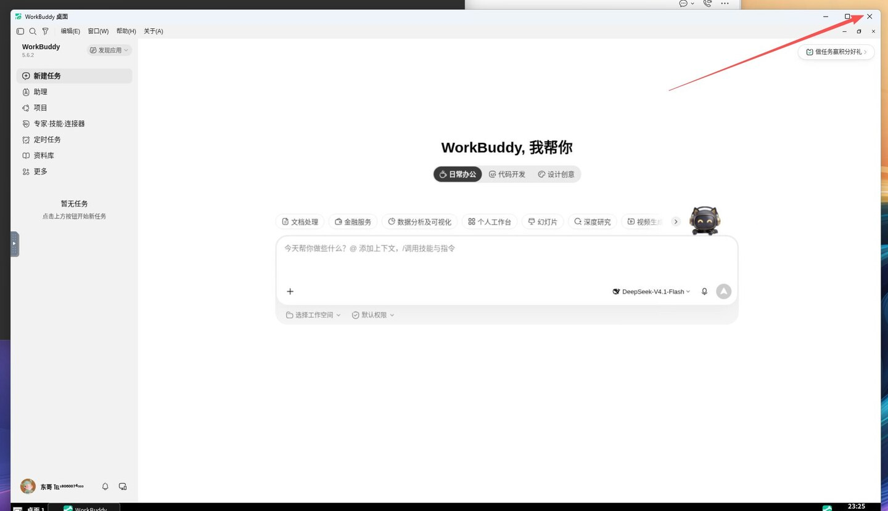

# 桌面客户端与安装包制作

浏览器已经能用，为什么还要客户端？三个实际理由：

1. **没有地址栏和标签页**，看起来/用起来就是个本地应用；
2. **认证内置**，双击就进，不用每次输口令（口令以请求头方式注入）；
3. **托盘常驻**，点 ✕ 收进托盘，任务不会因为"手滑关窗"断掉。

客户端本体是一个很小的 Electron 壳，页面仍是远端那一套 `vnc.html` —— 也就是说**前端逻辑只有一份**，改页面不用重发客户端。



---

## 结构

```
client/
├── main.js                     # 主进程：认证注入、托盘、关闭策略、快捷键、配置读写
├── pages/
│   ├── offline.html            # 连不上时显示（带重试）
│   ├── settings.html           # 服务器 / 账号设置
│   └── settings-preload.js     # contextBridge 暴露的最小 IPC
├── assets/icon.png(.ico)       # 窗口与托盘图标
├── build/icon.ico              # 安装包与 exe 图标
├── default-config.example.json # 预置配置模板（私有部署用）
└── 打包Mac安装包.command        # macOS 一键出 dmg
```

### 认证怎么进去

远端网关是 HTTP Basic Auth。客户端在请求头上注入，页面本身完全不知道口令：

```js
const token = 'Basic ' + Buffer.from(user + ':' + pass).toString('base64');
session.defaultSession.webRequest.onBeforeSendHeaders(
  { urls: [`https://${host}/*`, `wss://${host}/*`] },
  (details, cb) => {
    details.requestHeaders['Authorization'] = token;
    cb({ requestHeaders: details.requestHeaders });
  }
);
```

> 注意 `wss://` 也要一起匹配，否则 WebSocket 握手会 401，表现为"页面能开但一直连接中"。

### 配置的优先级

1. 用户数据目录里的 `config.json`（设置窗口写入，跨版本保留）
2. 应用自带的 `default-config.json`（私有部署可预置，**不要提交到公开仓库**）
3. 代码里的占位默认值

```json
{ "server": "https://wb.example.com", "user": "demo", "pass": "******" }
```

### 关窗与托盘

- 页面注册了 `beforeunload`（noVNC 断线提示），Electron 默认会**因此拒绝关闭窗口**：表现为点 ✕ 毫无反应、连系统关闭消息都无效。必须显式忽略：

  ```js
  win.webContents.on('will-prevent-unload', e => e.preventDefault());
  ```

- 点 ✕ 收进托盘（首次弹气泡提示），真退出走托盘菜单或 `Ctrl+Shift+Q`。用 `quitting` 标志区分"关闭"和"退出"。
- 托盘左键单击显示/隐藏，双击显示；再次双击桌面图标会走 `second-instance`，直接唤回已隐藏的窗口。

### 快捷键

| 键 | 行为 |
| --- | --- |
| `F11` | 全屏切换 |
| `F5` | 重新加载页面 |
| `Ctrl+Shift+Q` | 退出 |
| 右键 | 连接菜单（重连/全屏/服务器设置/退出） |

---

## 打包 Windows

```bash
cd client
npm install            # 建议先配镜像，见下
npx electron-builder --win nsis --x64
```

产物在 `dist/`：`WorkBuddy桌面-1.0.0-Windows安装包.exe`（约 80 MB）。

### 中文安装界面

```json
"nsis": {
  "oneClick": false,
  "allowToChangeInstallationDirectory": true,
  "language": "2052",
  "installerLanguages": ["zh_CN"],
  "shortcutName": "WorkBuddy 桌面",
  "license": "build/许可协议.txt"
}
```

`2052` 是简体中文的 LCID，配合 `installerLanguages` 只保留中文，向导就不会出现语言选择页。

### 三个必须知道的坑

**1. 国内镜像**

```ini
# client/.npmrc
registry=https://registry.npmmirror.com
electron_mirror=https://npmmirror.com/mirrors/electron/
electron_builder_binaries_mirror=https://npmmirror.com/mirrors/electron-builder-binaries/
```

**2. 没有管理员权限时，`winCodeSign` 解压会失败**（内部要创建 darwin 符号链接）。绕法：

```json
"win": { "signAndEditExecutable": false }
```

然后手工补图标与版本信息：

```bash
RC="$LOCALAPPDATA/electron-builder/Cache/winCodeSign/<ver>/rcedit-x64.exe"
"$RC" "dist/win-unpacked/WorkBuddy 桌面.exe" \
  --set-icon build/icon.ico \
  --set-version-string ProductName "WorkBuddy 桌面" \
  --set-version-string FileDescription "WorkBuddy 桌面" \
  --set-file-version 1.0.0.0 --set-product-version 1.0.0.0
npx electron-builder --win nsis --x64 --prepackaged dist/win-unpacked
```

**3. 改了 `app.asar` 会启动即退出**

新版 Electron 会校验 asar 完整性（electron-builder 打包时把哈希写进 exe 资源）。**只替换 `resources/app.asar` 而保留旧 exe**，应用会瞬间退出且没有日志。就地更新请整体覆盖：

```powershell
robocopy dist\win-unpacked "C:\Path\To\Installed" /E
```

---

## 打包 macOS（Apple Silicon）

`.dmg` 无法在 Windows/Linux 上完整生成（需要 macOS 的 `hdiutil` 与签名链），所以提供一键脚本 `打包Mac安装包.command`：

```bash
open 打包Mac安装包.command     # 或在访达里双击
```

脚本做：检查 Node → `npm install` → `npx electron-builder --mac dmg --arm64` → 打开 `dist/`。

配置里 `mac.identity = null` 表示**不签名**。首次打开需要在「系统设置 → 隐私与安全性」里点"仍要打开"，或者：

```bash
xattr -dr com.apple.quarantine /Applications/WorkBuddy\ 桌面.app
```

> 有 Apple 开发者账号的话，把 `identity` 换成证书名并配置公证（notarize），就能免掉这一步。

---

## 版本与发布

```bash
# 1. 改 package.json 的 version
# 2. 重新打包
npx electron-builder --win nsis --x64
# 3. 上传安装包，更新 README 的下载链接
```

安装包**不需要**签名也能用，但 Windows SmartScreen 会提示"未知发布者"。要做正式分发就买一张代码签名证书（OV/EV）。

---

## 客户端本身的安全边界

- 客户端保存的是 Basic Auth 口令（`config.json` 明文）。它等价于"浏览器记住密码"，请确保系统账户本身可信。
- 不要把 `default-config.json` 提交到仓库：它含有部署口令。`.gitignore` 已屏蔽。
- 客户端只加载配置里的域名，`setWindowOpenHandler` 把外链交给系统浏览器，避免在壳内跳走。
